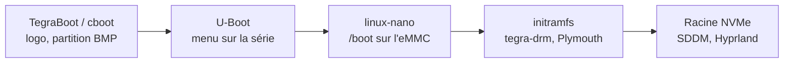

# jetson-nano-omarchy : reComputer J1020 v2

**[English](README.md) | Français**

[Omarchy](https://omarchy.org) sur le Seeed reComputer J1020 v2 (NVIDIA Jetson Nano 4 Go, module eMMC
P3448-0002 sur la carte J202) : noyau Linux 7.2 proche du mainline, pilote GPU NVIDIA `nvgpu` porté sur ce
noyau, CUDA 12.9 et bureau Hyprland accéléré.

Ce dépôt est un fork de [Kristianaaron/jetson-nano-omarchy](https://github.com/Kristianaaron/jetson-nano-omarchy),
écrit pour le dev kit NVIDIA B01 avec carte SD. Le portage du pilote et de CUDA vient de ce projet ; ce fork ajoute
la prise en charge de la J202, la veille, des corrections de fiabilité, des modes de puissance et un démarrage graphique.
**Avec un dev kit NVIDIA, utilise le projet d'origine.**

Projet de recherche, sans support de NVIDIA, Seeed ou Omarchy.

## État

Essayé sur une seule carte, version `j202-v1.1` (novembre 2026).

| Domaine | État |
|---|---|
| Bureau Omarchy 4.5 (Hyprland, SDDM) | fonctionne, rendu par le GPU (Mesa Zink sur le Vulkan 1.3 de NVIDIA) |
| Noyau `linux-nano` 7.2.11-5 | 14 correctifs Tegra210 ; racine sur SSD NVMe, `/boot` sur l'eMMC |
| `nvgpu-nano` 36.4.20261121-7 | chargé au démarrage ; 76,8 à 921,6 MHz, 1152 MHz en option |
| CUDA 12.9 | `nvcc`, exécution, `nanoblas` (sous-ensemble de cuBLAS) |
| HDMI | 1920x1080 à 60 Hz, EDID lu ; écran actif 5 s après le lancement du noyau |
| Mémoire | 1600 MHz (tables EMC de cboot), 15 à 20 Go/s vus par CUDA |
| Ethernet 1 Gb/s, NVMe, USB | fonctionnent |
| Bluetooth, son HDMI | détectés, usage peu essayé |
| Veille (SC7) | fonctionne, première veille et veille de 150 s comprises ; réveil par minuterie |
| Modes de puissance | quatre modes, menu graphique et ligne de commande |
| Démarrage graphique | logo du premier écran remplaçable, écran de chargement Plymouth |

### Modes de puissance

`jetson-nano-mode`, ou « Mode de puissance » dans le lanceur d'applications.

| Mode | CPU | GPU | Calcul CUDA (FMA FP32) |
|---|---|---|---|
| Éco | 918 MHz | 537 MHz | 108 GFLOPS |
| Normal (fréquences NVIDIA) | 1479 MHz | 921 MHz | 184 GFLOPS |
| Performance | 1683 MHz | 1075 MHz | 213 GFLOPS |
| Maximum | 1785 MHz | 1152 MHz | 228 GFLOPS |

Mesuré en mode Maximum : 13,9 W et 42 °C au pic (ventilateur actif), 2,8 W au repos. Calculs CPU et GPU
vérifiés, 0 erreur.

> [!WARNING]
> Performance et Maximum dépassent les fréquences garanties par NVIDIA. Ils ont passé des essais courts par
> palier et 2 h de charge CPU + GPU + mémoire au Maximum sans erreur, sur une seule puce. Ils sont désactivés tant que l'entrée de démarrage ne les demande pas.

## Matériel

- reComputer J1020 v2 et son bloc 12 V / 5 A, avec ventilateur.
- SSD NVMe M.2 Key M (la compilation complète prend environ 60 Go).
- Ethernet, écran HDMI, clavier.
- Adaptateur série USB **3,3 V** sur l'UART de la J202 (115200 8N1). Nécessaire en pratique : le menu de
  démarrage et les messages de secours passent par la série.
- PC x86_64 sous Linux ou WSL2 (Ubuntu 24.04) pour flasher l'eMMC et compiler le noyau.

## Installation

> [!CAUTION]
> L'étape 1 **efface toute l'eMMC**.

1. **Flasher l'eMMC.** Carte éteinte, cavalier FC REC sur GND, puis allumer. Sur le PC :
   `sudo bash scripts/flash-j202-emmc.sh` (sous WSL2, attacher d'abord l'USB avec `usbipd`, voir l'en-tête du script).
   Le bootloader est celui de NVIDIA (L4T R32.7.6) ; le système est Arch Linux ARM.
2. **Racine sur le NVMe.** Copier `/` sur le SSD et garder `/boot` sur l'eMMC
   ([docs/j202-plan.md](docs/j202-plan.md), phase 2).
3. **Configurer.** En root par SSH : `bash omarchy/nano/provision-nano.sh`.
4. **Pile Nano.** Pour ne pas recompiler le noyau, nvgpu et la configuration de la carte, télécharger les
   paquets de la [release](https://github.com/kevin03L/jetson-nano-omarchy/releases) et les placer dans le dépôt local :

   ```bash
   sha256sum -c SHA256SUMS
   install -d /var/lib/jetson-nano/repo
   cp *.pkg.tar.zst /var/lib/jetson-nano/repo/
   cd /var/lib/jetson-nano/repo && repo-add nano.db.tar.gz *.pkg.tar.zst
   ```

   Puis `bash scripts/build-nano-stack.sh` compile et installe le reste (Mesa, Hyprland, CUDA...). Il télécharge
   les fichiers de NVIDIA depuis les serveurs de NVIDIA. Essayer d'abord avec `--dry-run`.
5. **Redémarrer.** L'entrée `nano-cuda` lance le bureau et CUDA aux fréquences d'origine.
6. **Vérifier.** `/usr/lib/nanoblas/gemm_test` ne doit signaler aucun échec.

### Options

- **Fréquences plus hautes** : une entrée de démarrage séparée, copie de `nano-cuda`, avec en plus
  `nvgpu.gpu_max_khz=1152000 clk_tegra124_dfll_fcpu.max_khz=1785000 nano.cpu_max_khz=1785000`.
  Garder `nano-cuda` comme secours.
- **Alimentation** : `SUPPLY_W=20` dans `/etc/jetson-nano/power.conf` pour le bloc 12 V / 5 A.
- **Ventilateur** : `/etc/jetson-nano/fan.conf` (exemple fourni).
- **Écran de démarrage** : `omarchy/nano/bootlogo.py` pour le premier logo (il sauvegarde l'original), thème
  Plymouth `jetson-nano` pour le chargement. Les images sont à fournir ([docs/j202-plan.md](docs/j202-plan.md)).

## Démarrage



| Entrée | Rôle |
|---|---|
| `nano-cuda` | bureau et CUDA, fréquences d'origine (secours conseillé) |
| `nano` | pilote nouveau, sans CUDA |
| `nano-oc` (à ajouter) | bureau et CUDA, fréquences plus hautes |
| `mainline`, `nvme` | noyau d'Arch Linux ARM |

## Ce que ce fork corrige

| Problème | Correctif |
|---|---|
| Le GPU ne revenait pas après une coupure de sa tension | séquence d'alimentation de L4T (nvgpu 0002 à 0004, noyau 0106) : 3700 cycles, 0 échec |
| Le GPU restait bloqué à 537 MHz après certaines veilles | noyau 0110 (workqueue) |
| La veille de plus de 64 s redémarrait la carte | noyau 0113 (watchdog du PMIC) |
| La première veille après un démarrage ne revenait jamais | noyau 0114 (horloge de l'UART A) |
| Veille : mémoire et SMMU mal restaurées | noyau 0107 et 0109 |
| Capteur de puissance muet après une veille | noyau 0111 |
| eMMC parfois absente au démarrage, HDMI sans 5 V | device tree J202 |
| Fermeture de session bloquée (Bluetooth) | signal d'arrêt de `bt-agent` |

Le détail, avec les mesures, est dans [docs/j202-plan.md](docs/j202-plan.md).

## Limites connues

- Performance et Maximum : 2 h de charge contrôlée (CPU, GPU, mémoire) au Maximum (14,4 W, 44 °C, 0 erreur), rien de plus long ; 3D non comprise.
- Réveil de veille au clavier ou au bouton : pas essayé.
- Pas de branchement HDMI à chaud ; brancher l'écran avant le démarrage.
- Après une extinction, la carte repart par une alarme de l'horloge (essayé) ; rebrancher le 12 V et le bouton d'alimentation ne sont pas essayés.
- L'installation avec les paquets de la release n'a pas été refaite depuis une carte vierge.
- Pas de cuFFT, cuDNN ni TensorRT : NVIDIA ne les fournit plus pour ce GPU avec CUDA 12.

## Crédits et licence

Projet d'origine et portage nvgpu/CUDA : [Kristianaaron](https://github.com/Kristianaaron/jetson-nano-omarchy).
Version J202 : kevin03L, avec Claude (Anthropic). Pilotes : NVIDIA et [OE4T](https://github.com/OE4T). Noyau :
[Arch Linux ARM](https://github.com/archlinuxarm/PKGBUILDs). Bureau : [Omarchy](https://github.com/basecamp/omarchy)
et [Hyprland](https://github.com/hyprwm/Hyprland). Liste complète dans le [README anglais](README.md#credits).

Scripts et documentation : MIT. Les correctifs gardent la licence du code modifié (noyau et pilotes : GPL-2.0).
Aucun binaire propriétaire de NVIDIA n'est distribué ici. Projet sans lien avec NVIDIA, Seeed, Omarchy ou Arch Linux ARM.
