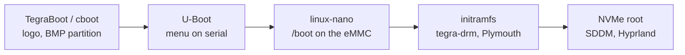

# jetson-nano-omarchy: reComputer J1020 v2

**English | [Français](README.fr.md)**

[Omarchy](https://omarchy.org) on the Seeed reComputer J1020 v2 (NVIDIA Jetson Nano 4 GB, eMMC module
P3448-0002 on the J202 carrier): a Linux 7.2 kernel close to mainline, NVIDIA's `nvgpu` driver ported to
it, CUDA 12.9 and the accelerated Hyprland desktop.

This is a fork of [Kristianaaron/jetson-nano-omarchy](https://github.com/Kristianaaron/jetson-nano-omarchy),
written for NVIDIA's B01 dev kit with an SD card. The driver and CUDA ports come from that project; this fork
adds J202 support, suspend, reliability fixes, power modes and a graphical boot. **With an NVIDIA dev kit, use
the original project.**

A research project, not supported by NVIDIA, Seeed or Omarchy.

## Status

Tested on one board, release `j202-v1.1` (November 2026).

| Area | State |
|---|---|
| Omarchy 4.5 desktop (Hyprland, SDDM) | works, rendered by the GPU (Mesa Zink on NVIDIA's Vulkan 1.3) |
| Kernel `linux-nano` 7.2.11-5 | 14 Tegra210 patches; root on an NVMe SSD, `/boot` on the eMMC |
| `nvgpu-nano` 36.4.20261121-7 | loads at boot; 76.8 to 921.6 MHz, 1152 MHz as an option |
| CUDA 12.9 | `nvcc`, runtime, `nanoblas` (a cuBLAS subset) |
| HDMI | 1920x1080 at 60 Hz, EDID read; picture 5 s after the kernel starts |
| Memory | 1600 MHz (cboot's EMC tables), 15 to 20 GB/s seen from CUDA |
| 1 Gb/s Ethernet, NVMe, USB | work |
| Bluetooth, HDMI sound | detected, little used so far |
| Suspend (SC7) | works, including the first one after a boot and one of 150 s; timer wake |
| Power modes | four modes, graphical menu and command line |
| Graphical boot | replaceable first boot logo, Plymouth loading screen |

### Power modes

`jetson-nano-mode`, or "Power mode" in the launcher.

| Mode | CPU | GPU | CUDA compute (FP32 FMA) |
|---|---|---|---|
| Eco | 918 MHz | 537 MHz | 108 GFLOPS |
| Normal (NVIDIA's clocks) | 1479 MHz | 921 MHz | 184 GFLOPS |
| Performance | 1683 MHz | 1075 MHz | 213 GFLOPS |
| Maximum | 1785 MHz | 1152 MHz | 228 GFLOPS |

Measured in Maximum: 13.9 W and 42 °C peak (fan running), 2.8 W idle. CPU and GPU results checked, 0 errors.

> [!WARNING]
> Performance and Maximum go beyond the clocks NVIDIA guarantees. They passed short tests per step and one
> 2 hour CPU + GPU + memory load at Maximum without an error, on one chip. They stay off unless the boot entry asks for them.

## What you need

- A reComputer J1020 v2 with its 12 V / 5 A supply and a fan.
- An M.2 Key M NVMe SSD (the full build takes about 60 GB).
- Wired Ethernet, an HDMI monitor, a keyboard.
- A **3.3 V** USB serial adapter on the J202's UART (115200 8N1). Needed in practice: the boot menu and the
  rescue messages are on the serial port.
- An x86_64 PC with Linux or WSL2 (Ubuntu 24.04) to flash the eMMC and build the kernel.

## Install

> [!CAUTION]
> Step 1 **erases the whole eMMC**.

1. **Flash the eMMC.** Board off, jumper FC REC to GND, then power on. On the PC:
   `sudo bash scripts/flash-j202-emmc.sh` (on WSL2, attach the USB device with `usbipd` first, see the script's
   header). The bootloader is NVIDIA's (L4T R32.7.6); the system is Arch Linux ARM.
2. **Root on the NVMe.** Copy `/` to the SSD and keep `/boot` on the eMMC
   ([docs/j202-plan.md](docs/j202-plan.md), phase 2, in French).
3. **Provision.** As root over SSH: `bash omarchy/nano/provision-nano.sh`.
4. **Nano stack.** To avoid building the kernel, nvgpu and the board policy, download the packages of the
   [release](https://github.com/kevin03L/jetson-nano-omarchy/releases) and put them in the local repository:

   ```bash
   sha256sum -c SHA256SUMS
   install -d /var/lib/jetson-nano/repo
   cp *.pkg.tar.zst /var/lib/jetson-nano/repo/
   cd /var/lib/jetson-nano/repo && repo-add nano.db.tar.gz *.pkg.tar.zst
   ```

   Then `bash scripts/build-nano-stack.sh` builds and installs the rest (Mesa, Hyprland, CUDA...). It downloads
   NVIDIA's files from NVIDIA. Run it with `--dry-run` first.
5. **Reboot.** The `nano-cuda` entry starts the desktop and CUDA at the stock clocks.
6. **Check.** `/usr/lib/nanoblas/gemm_test` must report no failure.

### Options

- **Higher clocks**: a separate boot entry, a copy of `nano-cuda` plus
  `nvgpu.gpu_max_khz=1152000 clk_tegra124_dfll_fcpu.max_khz=1785000 nano.cpu_max_khz=1785000`.
  Keep `nano-cuda` as the fallback.
- **Supply**: `SUPPLY_W=20` in `/etc/jetson-nano/power.conf` for the 12 V / 5 A adapter.
- **Fan**: `/etc/jetson-nano/fan.conf` (an example is installed).
- **Boot screen**: `omarchy/nano/bootlogo.py` for the first logo (it saves the original one), Plymouth theme
  `jetson-nano` for the loading screen. You supply the pictures ([docs/j202-plan.md](docs/j202-plan.md)).

## Boot



| Entry | Use |
|---|---|
| `nano-cuda` | desktop and CUDA, stock clocks (recommended fallback) |
| `nano` | nouveau driver, no CUDA |
| `nano-oc` (add it yourself) | desktop and CUDA, higher clocks |
| `mainline`, `nvme` | Arch Linux ARM's kernel |

## What this fork fixes

| Problem | Fix |
|---|---|
| The GPU never came back after its rail was cut | L4T's power sequence (nvgpu 0002 to 0004, kernel 0106): 3700 cycles, 0 failures |
| The GPU stayed at 537 MHz after some suspends | kernel 0110 (workqueue) |
| Suspends over 64 s reset the board | kernel 0113 (PMIC watchdog) |
| The first suspend after a boot never came back | kernel 0114 (UART A clock) |
| Suspend: memory and SMMU not restored | kernel 0107 and 0109 |
| Power sensor silent after a suspend | kernel 0111 |
| eMMC sometimes missing at boot, HDMI without 5 V | J202 device tree |
| Session logout hung (Bluetooth) | stop signal of `bt-agent` |

Details and measurements: [docs/j202-plan.md](docs/j202-plan.md) (French).

## Known issues

- Performance and Maximum: 2 hours of checked CPU, GPU and memory load at Maximum (14.4 W, 44 °C, 0 errors), nothing longer; 3D not included.
- Wake from suspend by keyboard or button: not tested.
- No HDMI hot-plug; connect the monitor before booting.
- After a power off, the board starts again with an RTC alarm (tested); plugging the 12 V supply again and the power button header are not tested.
- The install from the release packages has not been repeated from a blank board.
- No cuFFT, cuDNN or TensorRT: NVIDIA no longer ships them for this GPU with CUDA 12.

## Layout

| Path | Contents |
|---|---|
| `docs/` | engineering record; [j202-plan.md](docs/j202-plan.md) for this board |
| `packaging/` | Arch packages: kernel, nvgpu, firmware, board policy, Hyprland, Mesa, CUDA, nanoblas |
| `images/mainline-kernel/j202/` | J202 device tree |
| `omarchy/` | provisioning and configuration files |
| `scripts/` | eMMC flash, kernel cross build, stack builder |
| `results/`, `tests/`, `tools/` | measurements, test plans, CUDA experiments |

## Credits

J202 version: kevin03L, with Claude (Anthropic). It builds on other people's work:

| Who | What | Source | Licence |
|---|---|---|---|
| Kristianaaron | the original project: nvgpu, nvmap and CUDA 12 ports, Nano packages | [Kristianaaron/jetson-nano-omarchy](https://github.com/Kristianaaron/jetson-nano-omarchy) | MIT, patches GPL-2.0 |
| NVIDIA | nvgpu and nvidia-oot drivers, L4T firmware and userspace | [nv-tegra.nvidia.com](https://nv-tegra.nvidia.com) | GPL-2.0 (drivers); NVIDIA licence (firmware, userspace, not redistributed here) |
| OE4T (OpenEmbedded for Tegra) | maintained mirrors and patches of NVIDIA's R36 drivers | [OE4T/linux-nvgpu](https://github.com/OE4T/linux-nvgpu), [OE4T/linux-nv-oot](https://github.com/OE4T/linux-nv-oot) | GPL-2.0 |
| Arch Linux ARM (Kevin Mihelich, graysky) | `linux-aarch64` PKGBUILD, config and patches that `linux-nano` derives from | [archlinuxarm/PKGBUILDs](https://github.com/archlinuxarm/PKGBUILDs) | GPL-2.0 (kernel) |
| Omarchy (DHH and contributors) | the desktop this port runs | [basecamp/omarchy](https://github.com/basecamp/omarchy) | MIT |
| Omarchy packagers | `hyprland` and `aquamarine` package recipes and patches that `hyprland-nano` and `aquamarine-nano` extend | [omacom/omarchy-pkgs](https://github.com/omacom/omarchy-pkgs) | per package |
| hyprwm (Vaxry and contributors) | Hyprland and aquamarine | [hyprwm/Hyprland](https://github.com/hyprwm/Hyprland), [hyprwm/aquamarine](https://github.com/hyprwm/aquamarine) | BSD-3-Clause |
| Mesa, nouveau and Linux Tegra maintainers | GM20B graphics, Tegra210 support, EMC driver (Joseph Lo, Thierry Reding) | [mesa](https://gitlab.freedesktop.org/mesa/mesa), [kernel.org](https://kernel.org) | MIT / GPL-2.0 |

Not affiliated with or endorsed by NVIDIA, Seeed, Omarchy, Basecamp or Arch Linux ARM.

## Licence

Scripts, tools and documentation: MIT ([LICENSE](LICENSE)). Patches keep the licence of the code
they modify (kernel and drivers GPL-2.0, Mesa and Omarchy MIT). No NVIDIA binaries are included;
the scripts download them from NVIDIA's repositories and check their published SHA-256.
